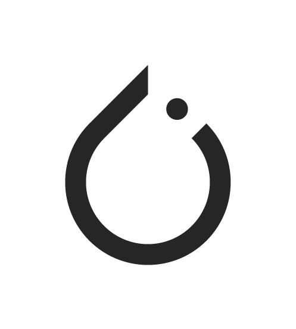

# PyTorch Logo

Official logo assets for PyTorch.

> **Tip:** The horizontal version of the PyTorch logo is preferred whenever space allows.

## Logo Assets

<table>
<tr><th>Version</th><th>Color</th><th>Preview</th><th>Download</th></tr>
<tr>
<th rowspan="4">Horizontal</th>
<td>Full Color</td>
<td align="center"></td>
<td align="center"><a href="./horizontal/PyTorch%20Logo%202022_RGB_PyTorchLogo_Horiz_fullColor_RGB.png">Download PNG</a></td>
</tr>
<tr>
<td>Full Color White</td>
<td bgcolor="#eaeef2" align="center"></td>
<td align="center"><a href="./horizontal/PyTorch%20Logo%202022_RGB_PyTorchLogo_Horiz_fullColorWhite_RGB.png">Download PNG</a></td>
</tr>
<tr>
<td>Black</td>
<td align="center"></td>
<td align="center"><a href="./horizontal/PyTorch%20Logo%202022_RGB_PyTorchLogo_Horiz_Black_RGB.png">Download PNG</a></td>
</tr>
<tr>
<td>White</td>
<td bgcolor="#eaeef2" align="center"></td>
<td align="center"><a href="./horizontal/PyTorch%20Logo%202022_RGB_PyTorchLogo_Horiz_White_RGB.png">Download PNG</a></td>
</tr>
<tr>
<th rowspan="4">Stacked</th>
<td>Full Color</td>
<td align="center"></td>
<td align="center"><a href="./stacked/PyTorch%20Logo%202022_RGB_PyTorchLogo_Stacked_fullColor_RGB.png">Download PNG</a></td>
</tr>
<tr>
<td>Full Color White</td>
<td bgcolor="#eaeef2" align="center"></td>
<td align="center"><a href="./stacked/PyTorch%20Logo%202022_RGB_PyTorchLogo_Stacked_fullColorWhite_RGB.png">Download PNG</a></td>
</tr>
<tr>
<td>Black</td>
<td align="center"></td>
<td align="center"><a href="./stacked/PyTorch%20Logo%202022_RGB_PyTorchLogo_Stacked_Black_RGB.png">Download PNG</a></td>
</tr>
<tr>
<td>White</td>
<td bgcolor="#eaeef2" align="center"></td>
<td align="center"><a href="./stacked/PyTorch%20Logo%202022_RGB_PyTorchLogo_Stacked_White_RGB.png">Download PNG</a></td>
</tr>
<tr>
<th rowspan="4">Vertical</th>
<td>Full Color</td>
<td align="center"></td>
<td align="center"><a href="./vertical/PyTorch%20Logo%202022_RGB_PyTorchLogo_Vertical_fullColor_RGB.png">Download PNG</a></td>
</tr>
<tr>
<td>Full Color White</td>
<td bgcolor="#eaeef2" align="center"></td>
<td align="center"><a href="./vertical/PyTorch%20Logo%202022_RGB_PyTorchLogo_Vertical_fullColorWhite_RGB.png">Download PNG</a></td>
</tr>
<tr>
<td>Black</td>
<td align="center"></td>
<td align="center"><a href="./vertical/PyTorch%20Logo%202022_RGB_PyTorchLogo_Vertical_Black_RGB.png">Download PNG</a></td>
</tr>
<tr>
<td>White</td>
<td bgcolor="#eaeef2" align="center"></td>
<td align="center"><a href="./vertical/PyTorch%20Logo%202022_RGB_PyTorchLogo_Vertical_White_RGB.png">Download PNG</a></td>
</tr>
<tr>
<th rowspan="3">Icon</th>
<td>Full Color</td>
<td align="center"></td>
<td align="center"><a href="./icon/PyTorchLogo_Icon_fullColor_RGB.png">Download PNG</a></td>
</tr>
<tr>
<td>Black</td>
<td align="center"></td>
<td align="center"><a href="./icon/PyTorchLogo_Icon_Black_RGB.png">Download PNG</a></td>
</tr>
<tr>
<td>White</td>
<td bgcolor="#eaeef2" align="center"></td>
<td align="center"><a href="./icon/PyTorchLogo_Icon_White_RGB.png">Download PNG</a></td>
</tr>
</table>
